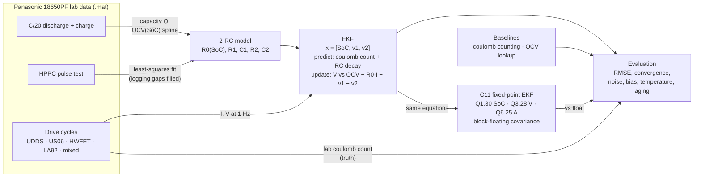
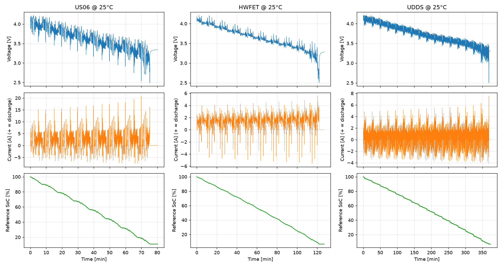
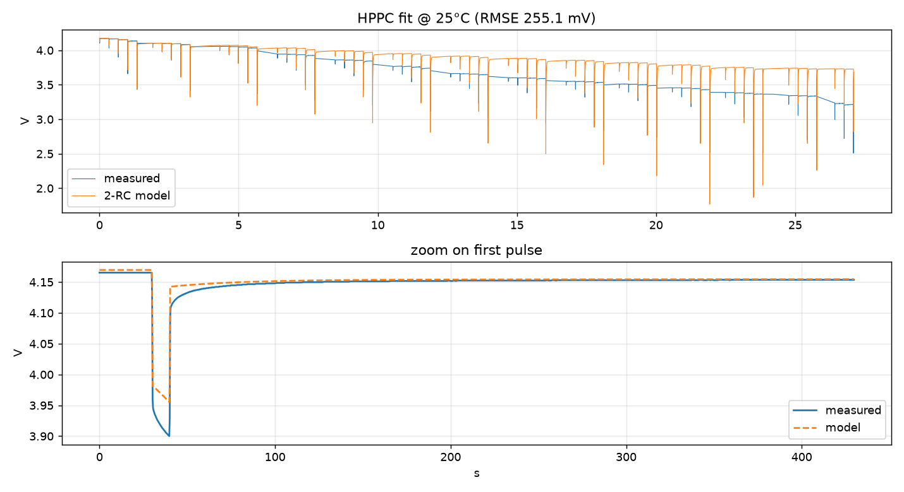
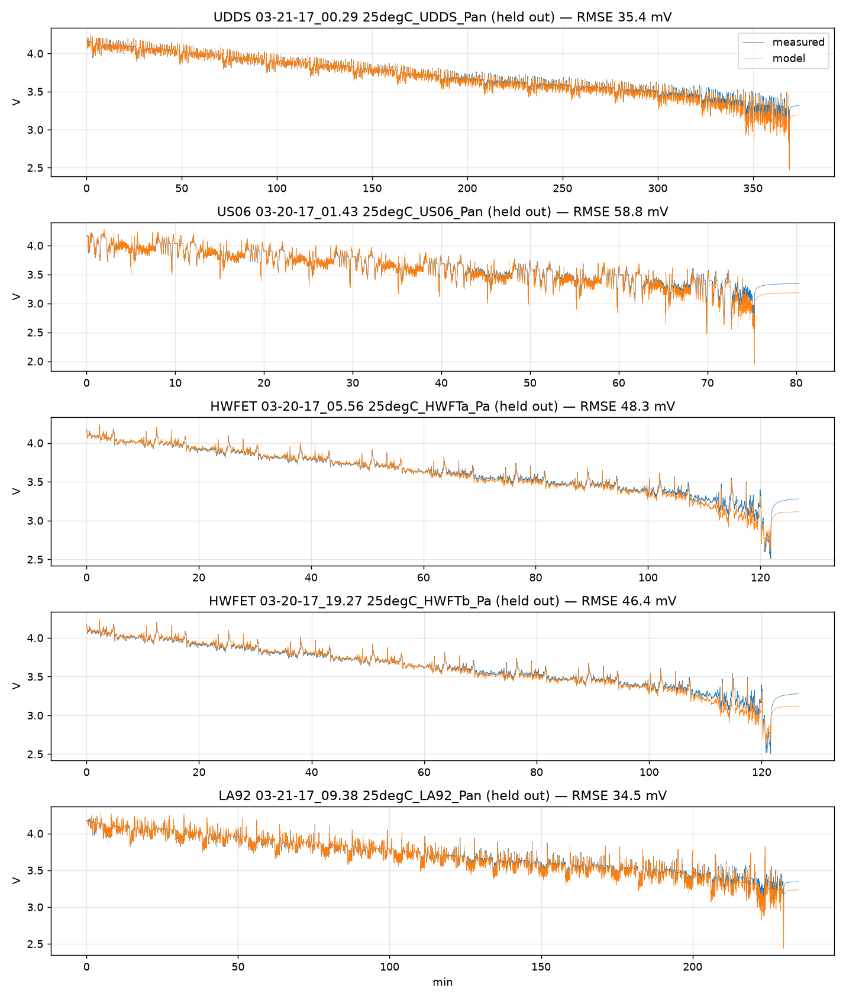
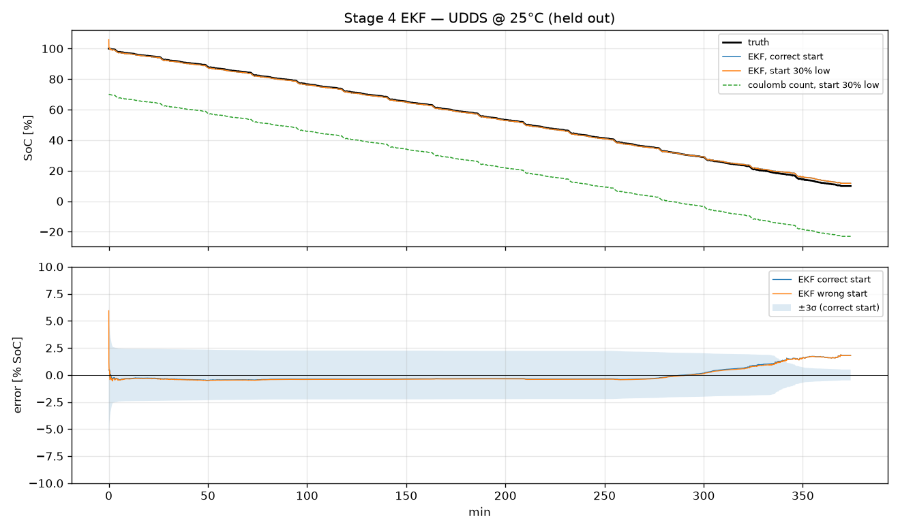
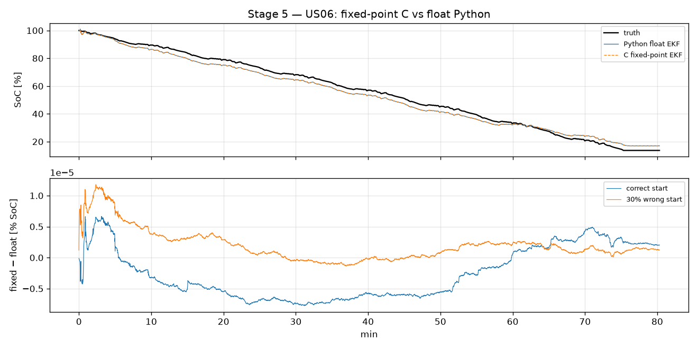
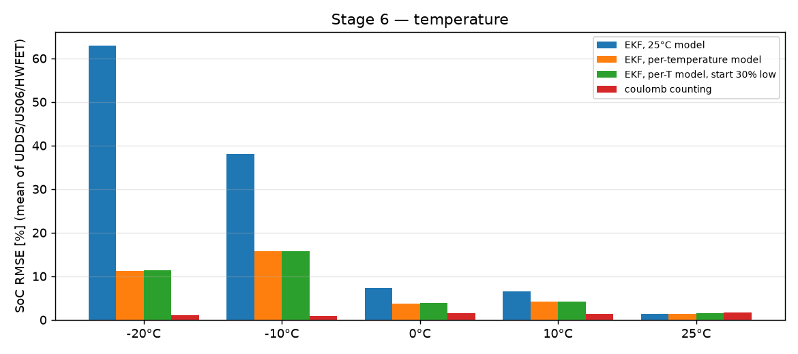
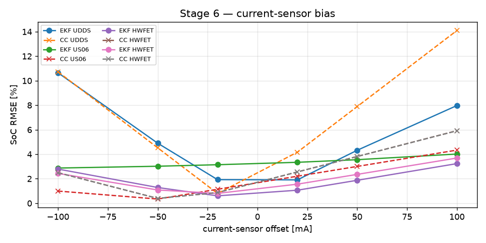

# soc-ekf — Li-ion state-of-charge EKF with a fixed-point C port

Estimates a lithium-ion cell's state of charge (SoC) from its voltage and current with an Extended Kalman Filter on a
2-RC equivalent-circuit model, then ports the filter to fixed-point C (int32/int64, no floating point in the update)
for a microcontroller BMS. Everything is fitted and tested on real lab data from a Panasonic NCR18650PF cell.

## Results

<!-- BEGIN:headline -->
| Cycle (held out, 25 °C) | EKF RMSE | EKF RMSE, start 30% low | EKF converges to ±2% | Coulomb counting, start 30% low | Voltage lookup |
|---|---|---|---|---|---|
| UDDS | 0.64% | 0.64% | 2 s | 31.5% | 8.3% |
| US06 | 3.21% | 3.37% | never | 31.5% | 19.8% |
| HWFET (a) | 0.63% | 0.71% | 2 s | 31.5% | 14.1% |
| HWFET (b) | 1.09% | 1.20% | 1 s | 31.5% | 14.4% |

Fixed-point C port: max difference from the float EKF **8.6e-06 % SoC** (RMS 3.2e-06 %), **81 ns per update** on an Apple M4 (double-precision C: 44 ns); estimated **654–1943 Cortex-M4 cycles** per update (op-count model, not measured on hardware).
<!-- END:headline -->

All numbers in this README are written by `scripts/update_readme.py` from `results/*.json`.

## How it works



**Model.** Terminal voltage `V = OCV(SoC) − R0(SoC)·I − v1 − v2`, with each RC pair `dv_k/dt = −v_k/τ_k + R_k(SoC)·I/τ_k`
(I > 0 = discharge). OCV and capacity come from the C/20 test (mean of the discharge and charge curves, which cancels
the IR drop and most hysteresis). R0, R1, R2 are piecewise-linear in SoC; τ1, τ2 are constants. They are fitted on the
HPPC test only and validated on drive cycles the fit never saw.

**EKF.** State `[SoC, v1, v2]`, updating at 1 Hz. The predict step is exact discretisation of the model with the
interval-mean current; the update compares measured and predicted voltage, with
`H = [dOCV/dSoC − dR0/dSoC·I, −1, −1]`. The three noise levels are tuned by grid search on LA92 and the mixed cycles;
UDDS, US06 and HWFET are held out for testing.

**Fixed-point C port** (`c/`). C11, int32 storage with int64 intermediates and saturating arithmetic. Formats: SoC
Q1.30, voltages Q3.28, current Q6.25, resistances Q0.31, slopes Q4.27, gain Q5.26. The covariance spans about
1e-12 to 0.06, more than one Q31 format can hold, so it is stored as block floating point (int32 mantissas, one
shared exponent) with a carry accumulator that keeps sub-LSB process noise instead of rounding it to zero.
Tests cover saturation and rounding edges, tracking the double-precision reference, and 100 000 steps of extreme or
garbage input under UBSan (no undefined behaviour, bounded state, recovery after re-initialisation).

## Data

Panasonic 18650PF Li-ion Battery Data, P. Kollmeyer, University of Wisconsin–Madison, Mendeley Data,
[doi:10.17632/wykht8y7tg.1](https://doi.org/10.17632/wykht8y7tg.1), CC-BY-4.0. Not included in this repo.

<!-- BEGIN:data -->
_Not run yet: `python scripts/inventory.py`._
<!-- END:data -->

Ground-truth SoC is lab coulomb counting from the tester's Ah counter, starting at 100% (every test begins after a
full charge), with the measured C/20 capacity. The HPPC files leave out the 10%-SoC discharges between pulse groups
(no samples there); the loader detects those logging gaps and restores the missing charge from the tester's Ah counter.

## Details

### Stage 2 — battery model
<!-- BEGIN:model -->
Capacity (C/20, 25 °C): **2.995 Ah** · OCV spline fit: 0.83 mV · HPPC fit (soc-dependent R): 21.3 mV · τ1 = 40.0 s, τ2 = 5000 s · HPPC logging gaps: 13 (charge from tester Ah)

| Held-out cycle | Voltage RMSE, constant R [mV] | Voltage RMSE, SoC-dependent R [mV] | Max error, selected [mV] |
|---|---|---|---|
| UDDS | 74.9 | 69.7 | 321 |
| US06 | 190.1 | 175.0 | 868 |
| HWFET (a) | 151.1 | 144.3 | 439 |
| HWFET (b) | 148.5 | 140.2 | 427 |
| LA92 | 103.4 | 91.8 | 439 |
<!-- END:model -->

### Stage 3 — baselines
<!-- BEGIN:baselines -->
RMSE / max error in % SoC. Coulomb counting uses the 2.9 Ah datasheet capacity; the wrong start is 30% low.

| Cycle | Coulomb count | Coulomb count, wrong start | OCV(V) lookup | OCV(V + R0·I) lookup |
|---|---|---|---|---|
| UDDS | 1.69 / 2.9 | 31.47 / 32.9 | 8.29 / 32.6 | 5.63 / 25.5 |
| US06 | 1.69 / 2.8 | 31.47 / 32.8 | 19.79 / 66.9 | 11.46 / 64.2 |
| HWFET (a) | 1.72 / 3.0 | 31.49 / 33.0 | 14.08 / 29.6 | 9.23 / 28.0 |
| HWFET (b) | 1.72 / 3.0 | 31.49 / 33.0 | 14.40 / 29.9 | 9.56 / 32.1 |
| LA92 | 1.64 / 2.8 | 31.42 / 32.8 | 11.41 / 40.8 | 7.11 / 37.7 |
<!-- END:baselines -->

### Stage 4 — EKF
<!-- BEGIN:ekf -->
EKF at 1 Hz, tuned by grid search on LA92, MIX, NN only: σ_v = 40 mV, σ_SoC,proc = 1e-06 /√s, σ_RC,proc = 1 mV/√s.

| Cycle | RMSE / max, correct start | RMSE / max, 30% low start | → ±5% | → ±2% | Current +5% (CC) | Current −5% (CC) | Noise* |
|---|---|---|---|---|---|---|---|
| UDDS | 0.64 / 1.9 | 0.64 / 5.9 | 1 s | 2 s | 2.48 (4.35) | 2.43 (0.98) | 0.66 |
| US06 | 3.21 / 4.1 | 3.37 / 5.5 | 1 s | never | 4.74 (4.33) | 2.13 (0.99) | 3.23 |
| HWFET (a) | 0.63 / 1.3 | 0.71 / 5.9 | 1 s | 2 s | 2.34 (4.43) | 1.76 (1.00) | 0.63 |
| HWFET (b) | 1.09 / 1.7 | 1.20 / 5.1 | 1 s | 1 s | 2.79 (4.43) | 1.48 (1.00) | 1.10 |

% SoC. *Gaussian noise, σ = 5% of the cycle's RMS current plus 5 mV on voltage.
<!-- END:ekf -->

### Stage 5 — fixed-point C port
<!-- BEGIN:cport -->
| Cycle | Updates | max \|fixed − float\| [% SoC] | RMS | max, wrong start | RMSE float | RMSE fixed | ns fixed (M4 Mac) | ns double |
|---|---|---|---|---|---|---|---|---|
| UDDS | 22448 | 7.4e-06 | 2.9e-06 | 9.1e-06 | 0.64 | 0.64 | 82 | 45 |
| US06 | 4819 | 7.8e-06 | 4.8e-06 | 1.2e-05 | 3.21 | 3.21 | 81 | 44 |
| HWFET (a) | 7613 | 5.2e-06 | 1.9e-06 | 1.8e-05 | 0.63 | 0.63 | 81 | 44 |
| HWFET (b) | 7598 | 8.6e-06 | 2.2e-06 | 1.3e-05 | 1.09 | 1.09 | 81 | 44 |

Ops per update: 39 mul, 85 add, 48 shift, 3 div, 24 load, 116 branch. Cortex-M4 estimate: **654–1943 cycles** (3.9–11.57 µs at 168 MHz) from per-op cost ranges in `scripts/compare_c.py` — an estimate, not a hardware measurement.
<!-- END:cport -->

### Stage 6 — robustness
<!-- BEGIN:robust -->
**Temperature** (mean SoC RMSE over UDDS/US06/HWFET, %)

| Temp | EKF, 25 °C model | EKF, per-temperature model | …start 30% low | Coulomb counting | Truth SoC at cutoff | HPPC fit [mV] |
|---|---|---|---|---|---|---|
| -20 °C | 62.94 | 11.27 | 11.35 | 1.00 | 50% | 33.9 |
| -10 °C | 38.07 | 15.74 | 15.73 | 0.93 | 55% | 24.3 |
| 0 °C | 7.30 | 3.68 | 3.81 | 1.49 | 23% | 20.5 |
| 10 °C | 6.57 | 4.21 | 4.16 | 1.44 | 36% | 19.1 |
| 25 °C | 1.39 | 1.39 | 1.48 | 1.70 | 11% | – |

**Aging** — capacity 2.995 → 2.396 Ah (20.0% fade; ASSUMED 20% fade (no end-of-tests C/20 file found)). Emulated on the 25 °C cycles: the estimators keep the fresh capacity.

| Cycle | EKF, right capacity | EKF, fresh capacity | Coulomb counting, fresh capacity |
|---|---|---|---|
| UDDS | 0.64 | 8.98 | 8.96 |
| US06 | 3.21 | 6.31 | 8.97 |
| HWFET (a) | 0.63 | 8.90 | 9.16 |
| HWFET (b) | 1.09 | 8.28 | 9.15 |

**Current-sensor bias** — SoC RMSE %, EKF (coulomb counting)

| Offset | UDDS | US06 | HWFET (a) | HWFET (b) |
|---|---|---|---|---|
| -100mA | 10.65 (10.73) | 2.87 (0.99) | 2.79 (2.50) | 2.44 (2.49) |
| -50mA | 4.90 (4.52) | 3.02 (0.34) | 1.28 (0.39) | 1.08 (0.39) |
| -20mA | 1.93 (0.80) | 3.14 (1.14) | 0.60 (0.87) | 0.80 (0.87) |
| +20mA | 1.91 (4.17) | 3.34 (2.21) | 1.06 (2.56) | 1.56 (2.55) |
| +50mA | 4.32 (7.89) | 3.55 (3.00) | 1.87 (3.82) | 2.36 (3.81) |
| +100mA | 7.97 (14.10) | 4.02 (4.34) | 3.23 (5.92) | 3.69 (5.91) |
<!-- END:robust -->

## Plots

<!-- BEGIN:plots -->
**Drive cycles at 25 °C: voltage, current, reference SoC**



**OCV curve and slope from the C/20 test**


**2-RC fit on the HPPC test**



**Model voltage on held-out drive cycles**



**EKF on US06: correct start, 30% low start, coulomb counting**


**EKF on UDDS**



**Fixed-point C vs float Python**



**SoC RMSE vs temperature**



**SoC RMSE vs current-sensor bias**


<!-- END:plots -->

## Limitations

- **Truth is coulomb counting** with lab-grade sensors from a known full start, the standard reference for this
  dataset, but not an independent SoC measurement.
- **Model error grows with current.** On aggressive cycles (US06, 15–20 A peaks) the 2-RC model's voltage error maps
  to several % of SoC in the flat middle of the OCV curve. Current-dependent measurement noise or a hysteresis state
  would be the next step.
- **OCV is from 25 °C only**; other temperatures refit R and τ but keep the 25 °C OCV and capacity.
- **Aging is emulated**: the dataset has no drive cycles on the aged cell, so the test gives the estimators the
  fresh capacity on the 25 °C cycles, using the measured fade.
- **Cortex-M4 cycles are an estimate** from counted operations and per-operation cost ranges, not a measurement on
  hardware. The ns-per-update figures are measured on an Apple M4.

## Run it

```bash
python3.11 -m venv .venv && source .venv/bin/activate
pip install -r requirements.txt
# put the dataset's temperature folders in data/raw/ (any nesting)
pytest -q                          # Python tests + C unit/UBSan tests
python scripts/inventory.py        # stage 1: data inventory
python scripts/plot_cycles.py
python scripts/fit_model.py        # stage 2: OCV, capacity, 2-RC fit, validation
python scripts/baselines.py        # stage 3
python scripts/run_ekf.py          # stage 4: tune + test the EKF
sh c/build.sh                      # stage 5: build the C port (cc only; or use c/CMakeLists.txt)
python scripts/compare_c.py
python scripts/robustness.py       # stage 6
python scripts/update_readme.py    # stage 7: refresh this README from results/
```

## Layout

```
soc_ekf/      data.py (loaders) · model.py (OCV, 2-RC, fit, gaps) · fitting.py · baselines.py · ekf.py · cycles.py
scripts/      one script per stage + inspect_file.py + update_readme.py
c/            include/ src/ (ekf_q.c fixed point, ekf_f.c double reference) · tests/ · tools/ekf_trace.c · build.sh
tests/        pytest suite (synthetic cells with known parameters; real-data checks skip without the dataset)
results/      *.json written by the scripts      plots/   *.png
```
